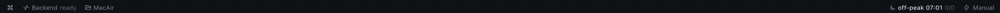

# offpeak-bekci

Ollama Cloud'un **off-peak penceresini görünür kılar**: durum çubuğu rozeti pencerenin geri
sayımını ve kuyrukta onay bekleyen/onaylı iş kalemlerini gösterir, pencere açılmadan
`on_bildirim_dk` dakika önce bir kez uyarır, onayı yalnız kullanıcıdan alır. Gövde tarafında
`llm_execution` middleware'i — yalnız Ollama Cloud çağrılarında ve yalnız peak penceresinde —
dakikalık çağrı hızını ölçer; `kuru_kosu: true` iken **hesaplar, uyumaz**.



Rozet: pencere/geri sayım · `ONAYLI/TOPLAM` sayaç · kota durumu. (Görsel: gerçek masaüstü
çubuğundan kırpılmış, ölçüm anına ait; `docs/rozet.png`.)

## Kurulum — tek satır

```bash
git clone https://github.com/onkanat/hermes-offpeak-bekci && hermes-offpeak-bekci/tools/kur.sh && hermes plugins enable offpeak-bekci
```

`tools/kur.sh` repoyu `$HERMES_HOME/plugins/offpeak-bekci` altına kopyalar (idempotent, uzak
indirme yok), yükleme yüzeyinin sha256'sını basar ve `hermes plugins validate` ile doğrular.
Başka bir profil için: `HERMES_HOME=~/.hermes/profiles/<profil> tools/kur.sh`. Bir değeri
değiştirmek için **kod düzenlemek gerekmez**: ayar `config.yaml` → `offpeak-bekci:` bloğuna yazılır.

Katalog girdisi (`plugin-catalog/offpeak-bekci.yaml`) **taslak**: PR açılmadı — repo henüz
herkese açık değil (GitHub 404) ve bu checkout'ta `origin` remote'u yok. Yayınlanıncaya kadar
yukarıdaki kaynak kurulumu geçerlidir.

## Komutlar

| Komut | Ne yapar |
| --- | --- |
| `/offpeak-durum` | Pencere, geri sayım, kayan pencere hızı, kota ve kuyruk sayacı — JSON. |
| `/offpeak-onayla <id,id>` | Kuyruk defterindeki kalemleri `onaylı` yapar (onaylayan **tek** yer kullanıcıdır). |
| `/offpeak-kur` | Kurulacak off-peak cron işini **tam** gösterir (iş adı, zamanlama, promptun tamamı, monitör, workdir, araç kümeleri, teslim) + `plan_hash`. **Hiçbir şey kurmaz.** |
| `/offpeak-kur onayla <plan_hash> [duraklat]` | Yalnız `plan_hash` tutuyorsa devam eder; kurulum **isteğini** oturuma bırakır, işi ajanın kendi `cronjob_manage` aracı kurar (host'a bağlı — bkz. *Hangi host'ta otomatik bırakılır?*). |
| `/offpeak-kaldir` | Bu profildeki offpeak işlerini listeler (id · zamanlama · durum · sonraki koşu). |
| `/offpeak-kaldir onayla <job_id>` | Yalnız listedeki bir id ile kaldırma **isteğini** oturuma bırakır (host'a bağlı — bkz. *Hangi host'ta otomatik bırakılır?*). |

Neden "istek"? Eklenti API'sinde cron işi **yaratma** yüzeyi yoktur (`register_command`/hook/
middleware vardır, iş kurucu yoktur). Kurulum bu yüzden kullanıcı onaylı bir mesajla oturuma
bırakılır; kararı ve kaydı ajanın cron aracı yapar. **Eklenti `jobs.json`'a hiçbir koşulda
yazmaz — yalnız okur.**

### Hangi host'ta otomatik bırakılır? (ölçülmüş sınır)

`ctx.inject_message(…)` çağrısını çekirdek host'a göre yönlendirir
(`hermes_cli/plugins_injection.py:18-32`):

| Host | Ne olur |
| --- | --- |
| **Klasik CLI** (terminal REPL — çekirdek burada CLI referansını kurar) | İstek CLI kuyruğuna girer, dönüş `True`; komut bitince ajan kurar. |
| **Ink TUI (`hermes --tui`) / masaüstü-panel** | Çekirdek **kalıcı `session_key`** ister. O anahtar komut handler'ına verilmez (`PluginContext` üyelerinde oturum alanı yok; `pre_command` kancası masaüstü `command.dispatch` yolunda atılmıyor) → dönüş `False`. |
| **Gateway oturumu** (`session_key` ya da `origin` eklentiye önceden verilmişse) | İstek o oturuma kuyruklanır — **ama** çekirdek önce kapıyı sorar: `plugins.entries.offpeak-bekci.allow_gateway_injection: true` (varsayılan **kapalı**). Kapalıysa uyarı basılır ve dönüş `False` (`hermes_cli/plugins.py:622-630`). |

Yani masaüstü/Ink host'unda komut "bu kanalda oturuma bırakılamadı" dalına düşer ve kurulacak
parametreleri **tek satır JSON** olarak basar: iş yine ajanın cron aracıyla kurulur, tek fark isteği
kullanıcı ajana verir (JSON'u yapıştır ya da `cronjob_manage` ile kur).

Oturum anahtarını okumanın tek süreç içi yolu `gateway.session_context.get_session_env`; bu modül
eklenti için **genel yüzey değil**: çekirdeğin kendi denetleyicisi yapay bir
`from gateway.session_context import get_session_env` importunu bulgu olarak döndürüyor
(`private_import_findings`), `hermes_constants.get_hermes_home` döndürmüyor. Kural 9 gereği bu yol
kullanılmaz; yani masaüstünde komut handler'ı anahtara ulaşamaz ve otomatik bırakma çalışmaz
(çözüm kullanıcı/çekirdek kararı: ya genel bir okuma yüzeyi, ya `allow_gateway_injection` + anahtar).
Regresyon testleri: `tests/test_kurulum.py::HostKanaliTest` (+ metin tarafı `HostBeyaniTest`).

Prova (işi kurup hemen kaldırmadan denemek):

```text
/offpeak-kur onayla <plan_hash> duraklat     # iş paused:true kurulur, zamanlanmaz
hermes cron list                             # iş görünür
/offpeak-kaldir onayla <job_id>              # geri alma
```

## Disclosure — ne okur, nereye yazar, ne tutar

**Okur:** yalnız `kuyruk_dosyasi` ayarının gösterdiği tek yerel dosya (varsayılan
`~/.hermes/offpeak-bekci/kuyruk.md`) — bekleyen/onaylı/koşulmuş kalemleri saymak için. Kurulum
komutları ayrıca cron deposunu (`<profil>/cron/jobs.json`) **salt okur**; depo yolu **genel
yüzeyden** türetilir (`hermes_constants.get_hermes_home()`), çekirdeğin özel `cron.jobs` modülü
**import edilmez** (katalog kural 9). `load_jobs()` bilerek kullanılmaz: o çağrı dizin açan
`ensure_dirs()` yapar (yan etki).

**Yazar:** (1) `olcum_dosyasi` ayarının gösterdiği yerel JSONL günlük (varsayılan
`~/.hermes/offpeak-bekci/olcum.jsonl`): ölçüm/uyarı/onay kayıtları; (2) kullanıcı
`/offpeak-onayla` verdiğinde **yalnız** `kuyruk_dosyasi` — dosyanın içeriğini eklenti üretmez,
kullanıcının kendi dosyasıdır, yazım atomiktir (geçici dosya + `os.replace`). Başka hiçbir yere
yazmaz; `jobs.json`, `config.yaml` ve site dosyaları yazma kapsamı **dışındadır**.

**Tutar (ayar):** aşağıdaki tablo. Tek beyan kaynağı `plugin.yaml` → `config_schema`'dır; kod
varsayılanı oradan okur. Kurulumun kendi değerleri `config.yaml` → `offpeak-bekci:` bloğunda
durur; eklentiye kullanıcıya özel hiçbir yol gömülmez.

**Yapmaz:** ağ çağrısı yok, telemetri yok, sır/parola/token okumaz-yazmaz, kabuk/süreç
çalıştırmaz, uzaktan kod indirmez, kendi kendini güncellemez, başka profil/makineye dokunmaz.
Masaüstü yarısı (`desktop/plugin.js`) yalnız eklenti SDK yüzeyini kullanır: prototip yamalama,
`eval`, DOM sorgulama yok.

## Ayarlar

| Ayar | Varsayılan | Anlamı |
| --- | --- | --- |
| `kuru_kosu` | `true` | `true` iken ölçer/kaydeder, **bekleme uygulamaz**. |
| `kuyruk_dosyasi` | `~/.hermes/offpeak-bekci/kuyruk.md` | Kuyruk defterinin yolu (tek okuma kaynağı). |
| `schedule` | `5 18 * * 1-5` | Off-peak penceresinin açılışı (cron, UTC) — `/offpeak-kur` planında kullanılır. |
| `on_bildirim_dk` | `30` | Uyarının pencere öncesi başlangıcı (dk). |
| `hedef_hiz_dk` | `6` | Peak'te dakikada en fazla kaç çağrı (kayan `pencere_sn` penceresi). |
| `erteleme_tavani_sn` | `30.0` | Tek istek için en fazla bekleme (gecikme tavanı). |
| `pencere_sn` | `60.0` | Kayan hız penceresinin uzunluğu (sn). |
| `kota_tavani` | `120` | Kota penceresinde en fazla çağrı; aşılırsa uyarı kaydı (istek iptal edilmez). |
| `kota_penceresi_sn` | `3600.0` | Kota sayacının penceresi (sn). |
| `kota_token_gun` | `0` | Günlük taze token tavanı; `0` = tavan yok. |
| `cache_read_tavani_gun` | `0` | Günlük cache-read token tavanı; `0` = tavan yok. |
| `off_peak_only_isler` | `[]` | Yalnız off-peak'te koşması gereken iş adları (beyan). |
| `olcum_dosyasi` | `~/.hermes/offpeak-bekci/olcum.jsonl` | Ölçüm/uyarı günlüğü (JSONL, yerel). |

## Geliştirme

```bash
python3 -m unittest discover -s tests -t .   # python kapıları
node --test tests/desktop/plugin.test.mjs    # masaüstü kapıları
node tools/build-desktop.mjs --check         # gömülü plugin.js beyat mı (EXIT=0)
hermes plugins validate . --install-deps     # manifest doğrulaması
```

Prova/ölçüm araçları: `tools/kuru_kosu_olcum.py` (canlı config ile kuru koşu ölçümü).

Sınır: gerçek kuyruk defterine ölçüm amaçlı **yazılmaz**; kurulum komutları kullanıcı onayı
olmadan iş kurmaz ve `kuru_kosu` ayarını değiştirmez.
